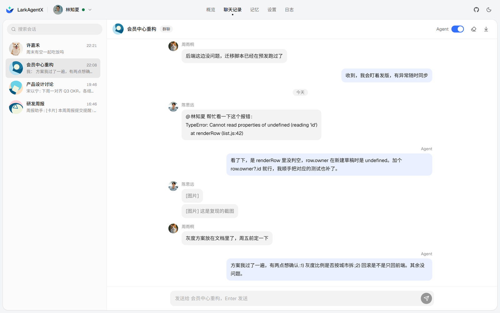
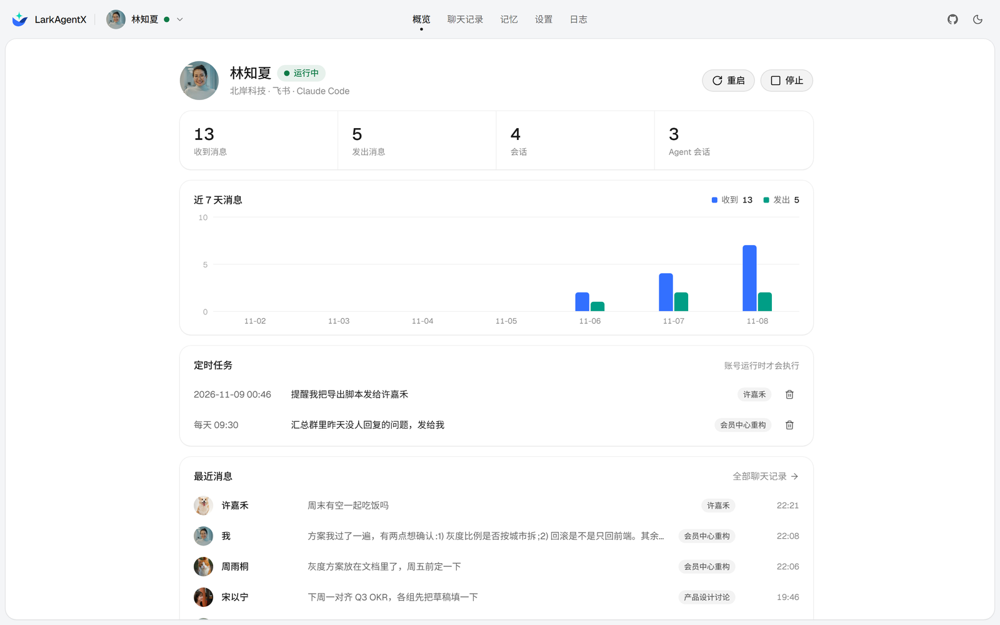

<a href="https://larkagentx.cvcat.site">
  <picture>
    <source media="(prefers-color-scheme: dark)" srcset="static/resource/hero-zh-dark.webp">
    
  </picture>
</a>

<div align="center">

[](pyproject.toml)
[](https://github.com/cv-cat/LarkAgentX/stargazers)
[](#快速上手)
[](#为什么用-larkagentx)

[主页](https://larkagentx.cvcat.site) · **简体中文** · [English](README_EN.md)

</div>

LarkAgentX 让你的飞书账号直连本地的 coding agent。扫码登录后，收到的消息交给本机的 Claude Code 或 Codex 处理，回复以你的账号发出。无需配置飞书机器人，飞书和 Lark 都支持。

> 飞书协议来自 [OpenFeiShuApis](https://github.com/cv-cat/OpenFeiShuApis)。

<div align="center">

<a href="https://api.openai-next.com">
  <picture>
    <source media="(prefers-color-scheme: dark)" srcset="static/resource/sponsors/vectrust-dark.png">
    
  </picture>
</a>

<sub>[Vectrust](https://api.openai-next.com) @ OpenDev Org & NextRouter Alliance</sub>

</div>

## 快速上手

```bash
git clone https://github.com/cv-cat/LarkAgentX.git && cd LarkAgentX
pip install -e .
lark web            # 打开 http://127.0.0.1:8765 ，扫码添加账号
```

本机需要装好 Claude Code 或 Codex。扫码用飞书 App 里的「扫一扫」。

## 控制台




账号、聊天记录、回复方式、agent 和触发规则都在这里管理，保存后立即生效。[在线体验](https://larkagentx.cvcat.site/console)

## 为什么用 LarkAgentX


- **不用建机器人。** 直接用你自己的飞书账号收发消息。
- **接本地的 agent。** Claude Code 或 Codex 都行，每个会话有自己的上下文。
- **多账号。** 飞书和 Lark 账号可以同时在线，同一个账号只会运行一处。
- **数据在本地。** 登录凭证和消息都存在 `~/.larkx/`。

<br clear="right">

## 命令行

```bash
lark auth qr                      # 扫码登录，Lark 账号加 --region lark
lark listen --agent               # 收消息并交给 agent
lark send <chat_id> <text>        # 发消息；-m 按 markdown 发，--image、--file 发图片和文件，--mention 真正 @ 人
lark recall <msg_id>              # 撤回自己发的消息
lark forward <msg_id> --to <id>   # 转发；--merge 合并成一条聊天记录
lark memory add "<内容>"          # 长期记忆；lark memory 查看，edit、rm 修改和删除
lark task add --in 30m "<内容>"   # 定时任务；也可以用 --at、--daily，lark task 查看
lark history <chat_id> --save     # 拉历史消息
lark api <type> '<json>'          # 调任意网关接口
```

配置写在 `.env`，见 [`.env.example`](.env.example)。agent 以免确认模式运行，可以执行任意命令，只对信任的会话开启。

## 参与贡献


欢迎提交 Issue 和 Pull Request。前端在 `webui/`，`npm run build` 输出到 `larkx/web/static/`。

<br clear="right">

## Star 趋势

<a href="https://cvcat.site/star-history/svg?repos=cv-cat/LarkAgentX&type=Date">
  <picture>
    <source media="(prefers-color-scheme: dark)" srcset="https://cvcat.site/star-history/svg?repos=cv-cat/LarkAgentX&type=Date&theme=dark" />
    <source media="(prefers-color-scheme: light)" srcset="https://cvcat.site/star-history/svg?repos=cv-cat/LarkAgentX&type=Date" />
    
  </picture>
</a>

## 🍔 交流群

如果你对爬虫和 AI Agent 感兴趣，可以加入群聊一起讨论~

ps: 请加群，人满或者过期 issue | wx 提醒 | qq提醒

| group-1 | group-2 | group-3 | group-4 (2000人qq群) |
|:--:|:--:|:--:|:--:|
|  |  |  |  |

<details>
<summary>免责声明</summary>

<br>

- 仅供学习和研究使用，不得用于商业或违法用途。
- 通过飞书网页版的内部协议工作，不是官方接口。请遵守飞书 / Lark 的服务条款和当地法律。
- 自动收发消息可能触发风控，导致账号受限或被封，后果自负。
- 与飞书、Lark 及其运营方无关，名称和商标归各自所有者。

</details>
