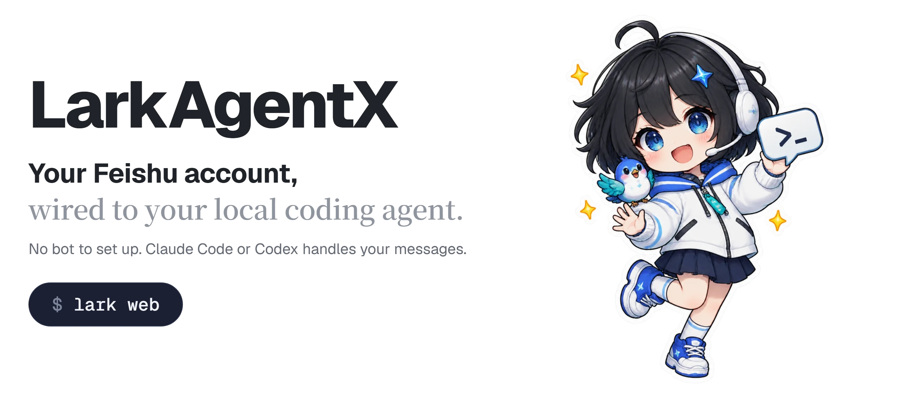
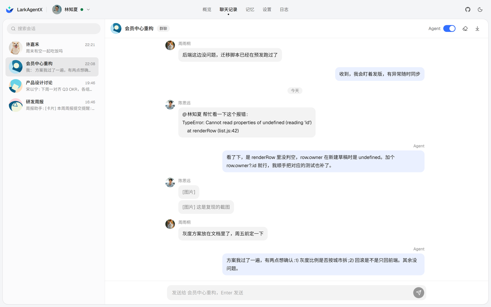
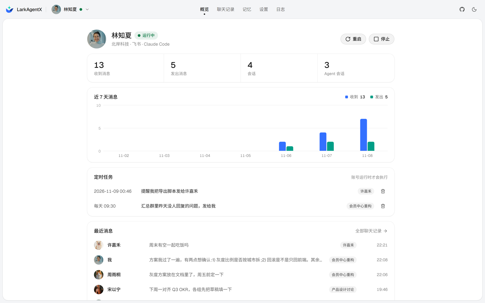

<a href="https://larkagentx.cvcat.site">
  <picture>
    <source media="(prefers-color-scheme: dark)" srcset="static/resource/hero-en-dark.webp">
    
  </picture>
</a>

<div align="center">

[](pyproject.toml)
[](https://github.com/cv-cat/LarkAgentX/stargazers)
[](#quick-start)
[](#why-larkagentx)

[Website](https://larkagentx.cvcat.site) · [简体中文](README.md) · **English**

</div>

LarkAgentX connects your own Feishu account to a coding agent on your machine. After a QR-code login, incoming messages go to your local Claude Code or Codex, and replies are sent from your account. No Feishu bot to set up. Feishu and Lark are both supported.

<div align="center">

<a href="https://api.openai-next.com">
  <picture>
    <source media="(prefers-color-scheme: dark)" srcset="static/resource/sponsors/vectrust-dark.png">
    
  </picture>
</a>

<sub>Sponsored by [Vectrust](https://api.openai-next.com) @ OpenDev Org & NextRouter Alliance · [Want to appear here?](mailto:992822653@qq.com)</sub>

</div>

## Quick start

```bash
git clone https://github.com/cv-cat/LarkAgentX.git && cd LarkAgentX
pip install -e .
lark web            # open http://127.0.0.1:8765 and add an account by QR code
```

Claude Code or Codex must be installed on the same machine. Scan with the scanner inside the Feishu app.

## Web console




Accounts, chat history, reply modes, the agent and trigger rules are all managed here. Changes apply right away. [Try the demo](https://larkagentx.cvcat.site/console).

## Why LarkAgentX


- **No bot.** Messages go in and out through your own Feishu account.
- **Your local agent.** Claude Code or Codex, with a separate context for every chat.
- **Multiple accounts.** Feishu and Lark accounts can run side by side; an account only ever runs in one place.
- **Local data.** Logins and messages stay in `~/.larkx/`.

<br clear="right">

## Command line

```bash
lark auth qr                      # log in by QR code; add --region lark for Lark
lark listen --agent               # receive messages and hand them to the agent
lark send <chat_id> <text>        # send a message; -m for markdown, --image / --file for attachments, --mention for a real @
lark recall <msg_id>              # recall a message you sent
lark forward <msg_id> --to <id>   # forward; --merge combines them into one chat record
lark memory add "<text>"          # long-term memory; lark memory lists it, edit / rm change or delete entries
lark task add --in 30m "<text>"   # scheduled task; --at and --daily also work, lark task lists them
lark history <chat_id> --save     # pull message history
lark api <type> '<json>'          # call any gateway API
```

Configuration goes in `.env`; see [`.env.example`](.env.example). The agent runs without permission prompts and can run any command, so only enable it for chats you trust.

## Contributing


Issues and pull requests are welcome. The frontend lives in `webui/`; `npm run build` writes to `larkx/web/static/`.

<br clear="right">

## Star history

<a href="https://cvcat.site/star-history/svg?repos=cv-cat/LarkAgentX&type=Date">
  <picture>
    <source media="(prefers-color-scheme: dark)" srcset="https://cvcat.site/star-history/svg?repos=cv-cat/LarkAgentX&type=Date&theme=dark" />
    <source media="(prefers-color-scheme: light)" srcset="https://cvcat.site/star-history/svg?repos=cv-cat/LarkAgentX&type=Date" />
    
  </picture>
</a>

## 🍔 Community

If you are interested in crawlers and AI agents, you are welcome to join the group chats (WeChat / QQ). If a group is full or the QR code has expired, please open an issue.

| group-1 | group-2 | group-3 | group-4 (2000-member QQ group) |
|:--:|:--:|:--:|:--:|
|  |  |  |  |

<details>
<summary>Disclaimer</summary>

<br>

- For learning and research only. Not for commercial or unlawful use.
- Works through the internal protocol of the Feishu web client, not an official API. Follow the Feishu / Lark terms and your local laws.
- Automated messaging can trigger risk control and get your account restricted or banned. You bear all consequences.
- Not affiliated with Feishu, Lark or their operators. Names and trademarks belong to their owners.

</details>
